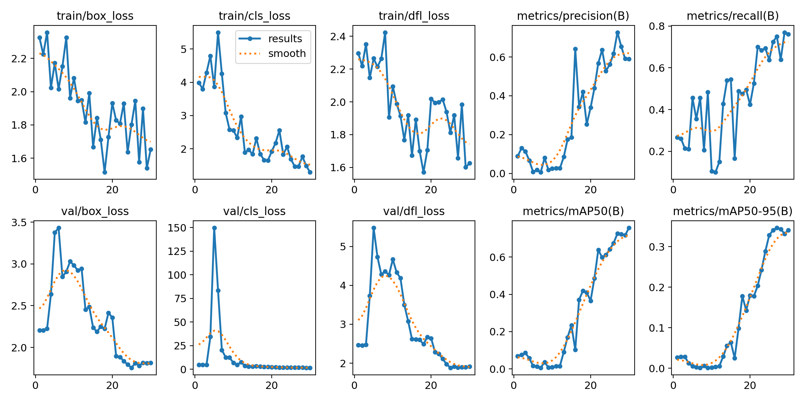
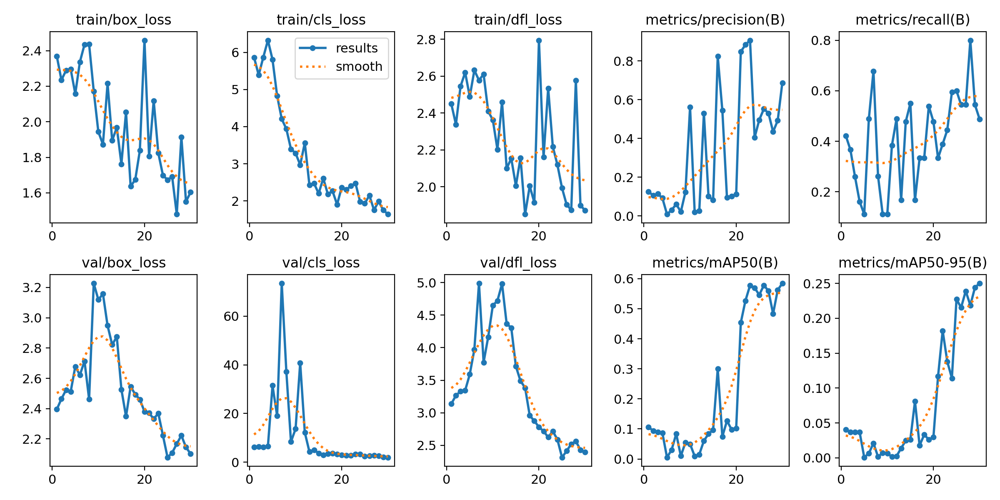
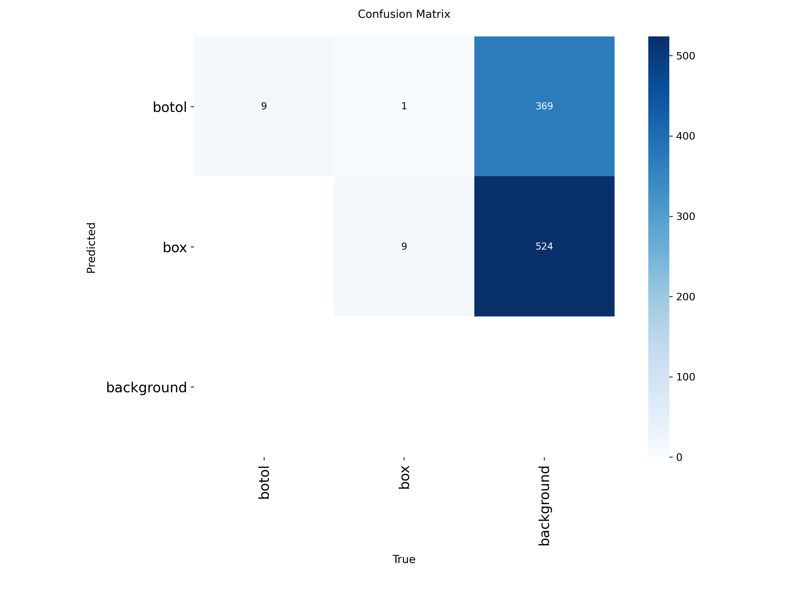

# Praktik Terpadu RET503: Data dan YOLO (Deteksi Botol dan Box)

- **Nama / NIM:** Nanik Purwaningrum / 4222401070
- **Kelompok / anggota:** [PBL NEXSUS OMNI 3 RODA]
- **Kelas objek:** `botol` (0) dan `box` (1)
- **Model:** YOLOv8n (Ultralytics 8.4.188, GPU Tesla T4 di Google Colab)


## 1. Data

| Item | Jumlah |
|---|---|
| Gambar mentah | 100 (50 `botol`, 50 `box`) |
| Gambar dipakai | 93 (43 `botol`, 50 `box`) |
| Gambar `botol` dibuang | 7 (hampir identik dengan gambar lain) |
| Instance per gambar | 1 kotak per gambar |

**Sumber data:** dataset PBL kelompok (berkas `dataset.zip`) berisi 50 gambar `botol` dan 50 gambar `box`. Asal pengambilan awal gambar tidak tercatat di dalam dataset.

**Anotasi:** bounding box digambar manual dengan alat `anotasi.py` (OpenCV), disimpan dalam format YOLO (`kelas cx cy w h`, ternormalisasi 0 sampai 1), lalu diperiksa dengan `01_cek_anotasi.py` (0 error, 0 label kosong).

**Uji konversi:** YOLO ke COCO ke YOLO (`02_yolo_ke_coco.py`, `03_coco_ke_yolo.py`) lolos, selisih koordinat maksimum 4e-06 (93 gambar, 93 anotasi).

**Pembagian data** (`05_split_dataset_yolo.py`, seed 42):

| Bagian | Gambar | `botol` | `box` |
|---|---|---|---|
| train | 65 | 30 | 35 |
| val | 19 | 9 | 10 |
| test | 9 | 4 | 5 |

Gambar `botol` berasal dari rangkaian bingkai berurutan, sehingga bingkai yang mirip dikelompokkan dan satu kelompok tidak dipecah ke dua bagian (untuk mencegah kebocoran train ke val atau test).

## 2. Eksperimen

Semua eksperimen memakai `yolov8n`, 30 epoch, `imgsz=416` (kecuali E3), batch 16, seed 42. Dijalankan dengan `06_latih_bandingkan.py` (skrip buatan sendiri, bukan skrip dosen).

| Kode | Konfigurasi | Tujuan |
|---|---|---|
| E1 | bobot pretrained `yolov8n.pt` | acuan (transfer learning) |
| E2 | arsitektur `yolov8n.yaml`, bobot acak | efek tanpa pretrained |
| E3 | seperti E1, hanya `imgsz=640` | efek satu perubahan |

### Hasil pada data validasi

| Eksperimen | mAP50 | mAP50-95 | P | R | ms/gambar | menit |
|---|---|---|---|---|---|---|
| E1_pretrained | 0.726 | 0.346 | 0.726 | 0.750 | 6.3 | 0.7 |
| E2_scratch | 0.075 | 0.011 | 0.003 | 0.778 | 3.3 | 0.6 |
| E3_tuning (`imgsz=640`) | 0.585 | 0.250 | 0.670 | 0.544 | 10.6 | 0.8 |

Model terpilih (mAP50-95 val tertinggi): **E1_pretrained**. Kolom `ms/gambar` adalah ukuran kasar (satu kali jalan, termasuk efek pemanasan GPU).

### Hasil per kelas (E1, data validasi)

| Kelas | Instance | P | R | mAP50 | mAP50-95 |
|---|---|---|---|---|---|
| botol | 9 | 0.769 | 1.000 | 0.895 | 0.463 |
| box | 10 | 0.684 | 0.500 | 0.557 | 0.230 |

### Hasil pada data test (E1, dijalankan sekali)

| mAP50 | mAP50-95 | P | R |
|---|---|---|---|
| 0.978 | 0.591 | 0.768 | 0.950 |

### Gambar

- Kurva latih E1: `hasil_praktik/E1_pretrained/results.png`
- Kurva latih E3: `hasil_praktik/E3_tuning/results.png`
- Confusion matrix E1: `hasil_praktik/E1_pretrained/confusion_matrix.png`





## 3. Analisis

**E1 dan E2 (pengaruh pretrained).** mAP50 val E1 (0.726) jauh di atas E2 (0.075). Presisi E2 hampir nol (0.003) dengan recall 0.778, menandakan model E2 menghasilkan banyak kotak tetapi hampir semuanya salah. Arah selisihnya jelas, namun besarnya tidak boleh dibaca sebagai batas kemampuan model dari nol: 30 epoch pada 65 gambar latih terlalu pendek untuk melatih dari nol. Selisih ini mencerminkan data sedikit ditambah jadwal latih pendek.

**E1 dan E3 (pengaruh ukuran gambar).** Menaikkan `imgsz` dari 416 ke 640 menurunkan mAP50-95 val dari 0.346 menjadi 0.250, menurunkan recall dari 0.750 menjadi 0.544, dan memperlambat inferensi. Gambar asli kecil (`botol` 200 x 150, `box` 512 x 384), sehingga pembesaran ke 640 tidak menambah informasi, dan itu salah satu penjelasan yang masuk akal. Namun kurva latih (lihat di bawah) menunjukkan latihan belum konvergen pada epoch 30, sehingga perbedaan ini bisa juga mencerminkan perbedaan kecepatan konvergensi, bukan kualitas akhir. Dengan satu seed dan 19 gambar val, hasil ini dilaporkan sebagai pengamatan pada konfigurasi ini, bukan kesimpulan umum.

**Kurva latih E1.** Loss latih turun (box 2.3 ke 1.65, cls 4.0 ke 1.3). mAP50 val naik hampir terus-menerus dan masih naik pada epoch 30 (sekitar 0.75 pada epoch terakhir), sedangkan mAP50-95 hampir mendatar di sekitar 0.34 pada beberapa epoch terakhir. Model terbaik (`best.pt`) dipilih berdasarkan mAP50-95 dan berasal dari epoch 27 dari 30. Kenaikan mAP50 yang belum berhenti menandakan latihan 30 epoch belum jenuh. Pada awal latihan `val/cls_loss` melonjak (sekitar 150 pada epoch 5) lalu turun, tanda ketidakstabilan awal yang akhirnya pulih. Kurva yang bergerigi wajar karena val hanya 19 gambar.

**Per kelas dan confusion matrix.** `botol` terdeteksi lebih baik daripada `box` (mAP50 0.895 vs 0.557). Ini bukan efek jumlah data: data latih `box` justru lebih banyak (35 vs 30). Confusion matrix (dibangun dengan ambang kepercayaan sangat rendah saat validasi) menunjukkan 9 dari 9 `botol` dan 9 dari 10 `box` cocok dengan kelas yang benar, 1 `box` terbaca sebagai `botol`, dan tidak ada objek yang sama sekali terlewat. Jadi `box` jarang hilang total, tetapi ditemukan dengan skor kepercayaan rendah dan bercampur dengan prediksi `box` palsu di latar belakang, sehingga recall pada ambang optimal hanya 0.50 dan mAP50-nya rendah. Angka prediksi latar yang besar (369 untuk `botol`, 524 untuk `box`) berasal dari ambang kepercayaan 0.001 yang dipakai untuk menghitung mAP, bukan dari perilaku model pada ambang pakai normal.
Pengamatan pada `val_batch0_pred.jpg` (16 dari 19 gambar val; 9 `botol` dan 7 `box`; kotak yang ditampilkan memakai ambang tampilan bawaan Ultralytics, sekitar 0,25):
- Skor kepercayaan `box` rendah sampai sedang (0,3 sampai 0,6), sedangkan `botol` sampai 0,7.
- Dua dari tujuh gambar `box` (`box_cardboard294`, `box_cardboard298`, keduanya kardus putih atau abu-abu dengan lipatan) tidak mendapat kotak sama sekali pada ambang tampilan itu.
- Satu gambar `box` (`box_cardboard216`, kardus coklat lusuh) diprediksi sebagai `botol` dengan skor 0,3, yang cocok dengan satu `box` yang terbaca `botol` di confusion matrix.
- Beberapa gambar mendapat dua sampai tiga kotak yang saling menimpa (`box_cardboard148`, `box_cardboard33`, serta beberapa gambar `botol`), yang menurunkan presisi.

Dugaan (belum diuji): tampilan kelas `box` jauh lebih beragam daripada `botol` (kardus coklat, putih, bermotif, berlabel) sementara data latihnya hanya 35 gambar, sehingga ciri umum `box` belum terpelajar dengan baik. Dugaan ini tidak dapat dipastikan tanpa eksperimen tambahan, misalnya menambah ragam gambar `box` atau melatih lebih lama.

**Hasil test.** E1 pada data test: mAP50 0.978 dan mAP50-95 0.591. Test hanya berisi 9 gambar (4 `botol`, 5 `box`), sehingga satu kesalahan saja mengubah angka sangat besar. Nilai test yang lebih tinggi daripada val (0.726) tidak berarti model lebih baik pada data baru, melainkan menunjukkan variasi sampel kecil dan kemungkinan test lebih mudah. Test dijalankan sekali sesuai aturan, tidak diulang untuk mencari angka yang lebih baik.

## 4. Keterbatasan

1. **Data kecil:** 93 gambar, val 19, test 9. Angka metrik memiliki ketidakpastian besar dan tidak diuji ulang dengan seed lain.
2. **Perbedaan domain antar kelas:** gambar `botol` dan `box` berbeda resolusi, latar, dan skala. Model dapat memanfaatkan perbedaan itu sebagai jalan pintas, sehingga hasil tidak otomatis berlaku untuk gambar `botol` dan `box` dari lingkungan lain.
3. **Bingkai `botol` berurutan:** meskipun dikelompokkan saat pembagian, bingkai dari satu rekaman berbagi latar yang sama, sehingga hasil val dan test cenderung optimis.
4. **Kelas seimbang** (43 vs 50): efek ketidakseimbangan kelas tidak dapat diamati pada data ini.
5. **Latihan 30 epoch** belum konvergen (mAP50 masih naik), sehingga perbandingan E1, E2, dan E3 mengukur kecepatan konvergensi sekaligus kualitas.
6. **Kotak `box` hampir sebesar gambar:** nilai mAP untuk `box` tidak sepenuhnya mencerminkan kemampuan mendeteksi objek dalam adegan nyata.

## 5. Cara mereproduksi

```
python 00_siapkan_data.py dataset_raw/dataset dataset_yolo
python anotasi.py dataset_yolo
python 01_cek_anotasi.py dataset_yolo
python 02_yolo_ke_coco.py dataset_yolo dataset_yolo/annotations_coco.json
python 03_coco_ke_yolo.py dataset_yolo/annotations_coco.json hasil_balik
python 05_split_dataset_yolo.py dataset_yolo dataset_v1
python 06_latih_bandingkan.py --nim 4222401070 --nama "Nanik Purwaningrum"
```

Pelatihan dijalankan di Google Colab (GPU T4).

## 6. Struktur repo

```
dataset_raw/        data mentah
dataset_yolo/       gambar dan label YOLO, annotations_coco.json
dataset_v1/         train / val / test dan data.yaml
hasil_praktik/      E1_pretrained, E2_scratch, E3_tuning, TEST_*
hasil_praktik_4222401070.txt / .csv
00_*.py ... 06_*.py, anotasi.py
README.md
```
